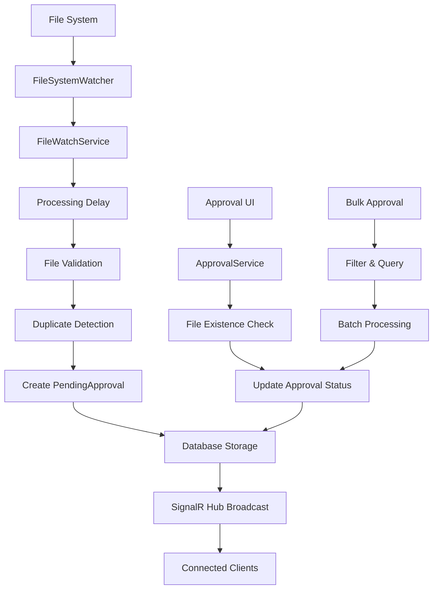
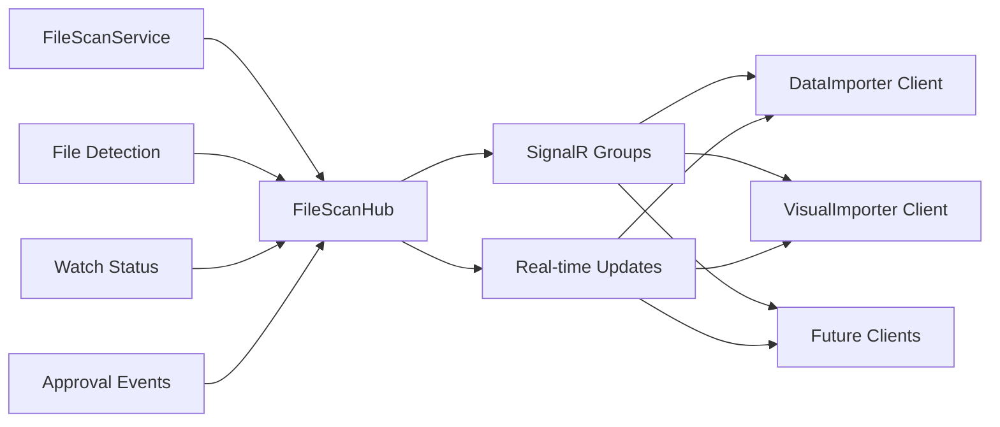
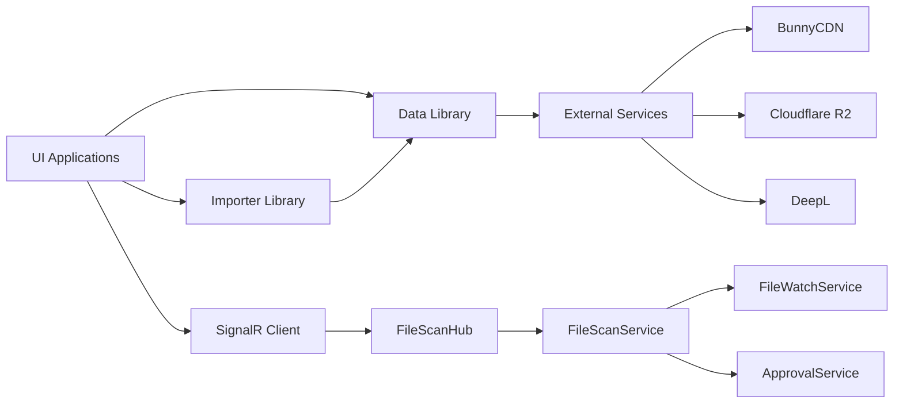

# AlUmmahNowTools - Solution Architecture

## ??? Overview

AlUmmahNowTools is a comprehensive .NET 8 solution for video content management, processing, and cloud storage operations. The solution follows modern architectural principles including clean architecture, dependency injection, separation of concerns, and real-time communication through SignalR.

## ?? Solution Structure

```
AlUmmahNowTools/
??? AlUmmahNow.Data/                    # Shared Data Library
??? AlUmmahNow.Importer/                # Core Import Logic Library  
??? AlUmmahNow.DataImporter/            # CLI SignalR Client Application
??? AlUmmahNow.BunnyBulkUploader/       # CLI Bulk Upload Application
??? AlUmmahNow.VisualImporter/          # WinUI 3 Visual Application
??? AlUmmahNow.FileScanService/         # SignalR Hub & Background Processing Service
??? AlUmmahNow.Tests/                   # Comprehensive Unit Tests
??? .github/copilot-instructions.md    # Development Guidelines
```

**Note**: `AlUmmahNow.FileScanApi` has been **REMOVED** and replaced with SignalR-based real-time communication.

## ?? Core Principles

### **Single Responsibility Principle**
- Each project has a distinct purpose and responsibility
- Classes are focused on specific domains (storage, import, validation, file watching, approval workflow)
- Clear separation between UI, business logic, and data access

### **Real-Time Communication**
- SignalR-based architecture for instant updates
- Event-driven file detection and approval workflows
- Group-based messaging for targeted notifications

### **Dependency Injection**
- All services registered in DI container
- Interface-based design for testability
- Configuration through dependency injection

### **Clean Architecture**
- Domain models in shared library
- Business logic separated from infrastructure
- UI layers depend on abstractions, not implementations

## ?? Project Architecture

### **AlUmmahNow.Data** - Shared Foundation
```
AlUmmahNow.Data/
??? Database/                   # Entity Framework DbContext
??? Models/                     # Domain Models
?   ??? FileScanning/          # File scanning & watch entities
?   ?   ??? WatchModels.cs     # Watch & approval models
?   ?   ??? ScanDtos.cs        # Data transfer objects
?   ??? Video/                 # Video-related models
?   ??? Storage/               # Storage abstractions
??? Storage/                    # Storage Implementations
?   ??? BunnyStorageClient.cs  # BunnyCDN integration
?   ??? R2Client.cs            # Cloudflare R2 integration
?   ??? IStorageClient.cs      # Storage abstraction
??? Video/                      # Video Services
?   ??? BunnyStreamClient.cs   # Video streaming API
??? Translation/                # Translation Services
    ??? DeepLClient.cs         # DeepL translation API
```

**Responsibilities:**
- ?? Domain models and entities for watch/approval workflows
- ?? Storage abstractions and implementations
- ?? External service integrations (BunnyCDN, Cloudflare R2, DeepL)
- ?? Database context and configurations
- ?? Data transfer objects for SignalR communication

**New Watch & Approval Models:**
- **ChannelWatch**: Configuration for file system monitoring
- **PendingApproval**: Files awaiting manual approval
- **Watch DTOs**: Real-time communication models
- **Approval DTOs**: Workflow management models

### **AlUmmahNow.Importer** - Business Logic Core
```
AlUmmahNow.Importer/
??? Core/                       # Core import interfaces
??? VideoImporter.cs           # Main import orchestrator
??? SimpleVideoUploader.cs     # Basic upload operations
??? ImportCommandExecutor.cs   # CLI command handling
```

**Responsibilities:**
- ?? Centralized import business logic
- ?? Session management and progress tracking
- ?? Retry logic and error handling
- ?? Cross-cutting concerns for all applications

### **AlUmmahNow.DataImporter** - SignalR Client Interface
```
AlUmmahNow.DataImporter/
??? Commands/                   # Command handlers
?   ??? CommandExecutor.cs     # Business operation execution
?   ??? CommandValidator.cs    # Input validation
??? Services/                   # Application services
?   ??? FileScanSignalRClient.cs # SignalR communication
??? Program.cs                 # Application bootstrap
```

**Responsibilities:**
- ?? Command line interface
- ?? SignalR client for real-time file scanning service
- ?? Input validation and routing
- ?? Console output formatting
- ?? Real-time progress updates via SignalR

**Replaced**: `FileScanApiClient.cs` ? `FileScanSignalRClient.cs` for real-time communication

### **AlUmmahNow.VisualImporter** - GUI Interface
```
AlUmmahNow.VisualImporter/
??? Views/                      # UI Views (XAML)
??? ViewModels/                 # MVVM ViewModels
??? Services/                   # UI-specific services
??? Models/                     # UI models
??? App.xaml.cs                # Application entry point
```

**Responsibilities:**
- ?? WinUI 3 visual interface
- ?? MVVM pattern implementation
- ?? Real-time progress visualization
- ?? Session management UI
- ?? **Future**: SignalR integration for real-time file watching

**Current State**: Uses local `FileDiscoveryService`, planned migration to SignalR client

### **AlUmmahNow.FileScanService** - SignalR Hub & Background Processing
```
AlUmmahNow.FileScanService/
??? Hubs/                       # SignalR Hubs
?   ??? FileScanHub.cs         # Real-time communication hub
??? Services/                   # Core services
?   ??? IWatchServices.cs      # Watch service interfaces
?   ??? FileWatchService.cs    # File system monitoring
?   ??? ApprovalService.cs     # Approval workflow management
?   ??? FileScanEngine.cs      # Scanning orchestration
?   ??? FileScanWorker.cs      # Background processing
??? Program.cs                 # Service host setup
```

**Responsibilities:**
- ?? **THE PRIMARY FILE SCANNING WORKER** - All file scanning happens here
- ?? SignalR Hub hosting for real-time communication
- ?? File system watching with configurable monitoring
- ?? Approval workflow management (manual approval/rejection)
- ?? Background processing with queue management
- ?? Real-time event broadcasting to connected clients
- ?? Database persistence for watches and approvals

**New Features Added:**
- **FileWatchService**: FileSystemWatcher integration with configurable delays
- **ApprovalService**: Manual approval workflow with bulk operations
- **FileScanHub**: SignalR hub with watch and approval methods
- **Real-time Events**: File detection, status changes, approval updates

## ?? Data Flow Architecture

### **Real-Time File Watch & Approval Flow**


### **SignalR Communication Architecture**


### **Service Dependencies**


## ?? Key Components

### **File Watch System**
- **FileWatchService**: FileSystemWatcher integration with configurable extensions
- **Processing Delay**: Configurable delay (1-60 seconds) to avoid incomplete file imports
- **Event-Driven**: Real-time file detection with SignalR broadcasting
- **Database Persistence**: Watch configurations and statistics stored in database
- **Resource Management**: Proper disposal and cleanup of file system watchers

**Supported Extensions**: `.mp4`, `.mkv`, `.avi`, `.mov`, `.wmv`, `.m4v`, `.flv`, `.webm`

### **Approval Workflow System**
- **Manual Approval**: Individual file approval/rejection workflow
- **Bulk Operations**: Advanced filtering by channel, size, date, extensions
- **Priority System**: 1=highest to 5=lowest priority with duplicate handling
- **Automatic Expiry**: 30-day default expiry for pending approvals
- **Duplicate Detection**: SHA256 content hashing for duplicate identification
- **File Existence Verification**: Ensures files exist before approval

### **SignalR Hub Features**
- **Real-Time Communication**: Instant updates for all connected clients
- **Group Management**: Targeted messaging based on client interests
- **Watch Methods**: Start, stop, update, delete file watches
- **Approval Methods**: Get pending, approve, bulk approve operations
- **Event Broadcasting**: File detection, status changes, approval updates

### **Storage Layer**
- **Abstraction**: `IStorageClient<T>` interface
- **Implementations**: 
  - `BunnyStorageClient` for BunnyCDN
  - `R2Client` for Cloudflare R2
- **Features**: Upload, download, list, delete operations

### **Import Engine**
- **VideoImporter**: Main orchestrator with session tracking
- **SimpleVideoUploader**: Basic upload functionality
- **Progress Tracking**: Real-time progress reporting
- **Resume Capability**: Interrupt and resume support

## ??? Database Architecture

### **Updated Entity Relationships**
```
ScanSession (1) ?????? (N) ScannedVideoFile
     ?
     ??? (1) ?????? (N) ScannedChannel

ImportSession (1) ?????? (N) ImportVideo
     ?
     ??? (1) ?????? (N) ImportChannel

ChannelWatch (1) ?????? (N) PendingApproval
     ?
     ??? IsActive, ProcessingDelaySeconds, SupportedExtensions

PendingApproval:
     ??? ChannelWatchId (FK)
     ??? FilePath, FileSize, ContentHash
     ??? Priority (1-5), Status, ExpiryDate
     ??? CreatedAt, UpdatedAt
```

### **New Entities**
- **ChannelWatch**: File system monitoring configuration
  - Directory path, supported extensions, processing delays
  - Active status, statistics, creation/update timestamps
- **PendingApproval**: Files awaiting manual approval
  - File metadata, content hash, priority, expiry
  - Approval status, timestamps, foreign key to watch
- **Indexes**: Optimized for common query patterns
  - ChannelWatch: IsActive, ChannelPath
  - PendingApproval: Status, ExpiryDate, Priority

### **Key Entities**
- **ScanSession**: File discovery sessions
- **ImportSession**: Upload operation sessions  
- **ScannedVideoFile**: Discovered video files
- **ImportVideo**: Videos being processed
- **Channels**: Organizational units (folders)
- **ChannelWatch**: File monitoring configurations
- **PendingApproval**: Manual approval workflow

## ?? Configuration Architecture

### **User Secrets Structure**
```json
{
  "R2DB": {
    "S3Api": "https://cloudflare-r2-endpoint",
    "S3Key": "access-key",
    "S3Secret": "secret-key"
  },
  "BunnyVideo": {
    "Zone": "bunny-video-zone",
    "Key": "bunny-api-key",
    "Region": "bunny-region"
  },
  "BunnyStream": {
    "Key": "bunny-stream-key"
  },
  "DeepL": {
    "ApiKey": "deepl-api-key",
    "IsFreeApi": false
  },
  "ConnectionStrings": {
    "DefaultConnection": "Server=(localdb)\\MSSQLLocalDB;Database=AlUmmahNowFileScan;Trusted_Connection=true"
  },
  "FileScanService": {
    "Url": "http://localhost:5000"
  }
}
```

### **FileScanService Configuration**
```json
{
  "Logging": {
    "LogLevel": {
      "Default": "Information",
      "Microsoft.AspNetCore.SignalR": "Debug"
    }
  },
  "ConnectionStrings": {
    "DefaultConnection": "Server=(localdb)\\MSSQLLocalDB;Database=AlUmmahNowFileScan;Trusted_Connection=true"
  },
  "Urls": "http://localhost:5000"
}
```

### **Configuration Hierarchy**
1. **User Secrets** (Development)
2. **Environment Variables** (Production)
3. **appsettings.json** (Defaults)
4. **Command Line Arguments** (Runtime)

## ?? Deployment Architecture

### **Development Environment**
- **IDE**: Visual Studio 2022 / VS Code
- **Runtime**: .NET 8.0 SDK
- **Database**: SQL Server LocalDB / SQLite
- **Storage**: Local file system (testing)
- **SignalR**: Development server on localhost:5000

### **Production Environment**
- **Runtime**: .NET 8.0 Runtime
- **Database**: SQL Server / SQLite
- **Storage**: Cloudflare R2 + BunnyCDN
- **Services**: Windows Services / Linux systemd
- **SignalR**: Production-ready hosting with scaling considerations

### **Deployment Targets**
- **Self-Contained**: Single executable with runtime included
- **Framework-Dependent**: Requires .NET 8 runtime
- **Platform-Specific**: Windows (GUI), Linux (CLI/API)

### **SignalR Deployment Considerations**
- **Connection Management**: Proper connection pooling and cleanup
- **Group Management**: Efficient group-based messaging
- **Load Balancing**: Redis backplane for multiple instances
- **Authentication**: Secure SignalR connection authentication

## ?? Security Architecture

### **Authentication & Authorization**
- **API Keys**: Secure storage in user secrets
- **Connection Strings**: Encrypted in production
- **SignalR Security**: Connection authentication and authorization
- **Access Control**: Service-level authentication

### **Data Protection**
- **Encryption in Transit**: HTTPS for all API calls, WSS for SignalR
- **Encryption at Rest**: Cloud storage encryption
- **Sensitive Data**: Excluded from logs and telemetry
- **File Hashing**: SHA256 for content verification and duplicate detection

## ?? Scalability Considerations

### **Performance Features**
- **Async/Await**: Non-blocking operations throughout
- **SignalR Streaming**: Real-time status updates
- **Chunked Uploads**: Large file handling
- **Connection Pooling**: Efficient HTTP client usage
- **Background Processing**: Queue-based file processing

### **File Watch Scalability**
- **Configurable Delays**: Prevents overwhelming system with rapid file changes
- **Resource Management**: Proper disposal of FileSystemWatcher instances
- **Database Optimization**: Indexed queries for watch and approval operations
- **Event Batching**: Efficient SignalR message batching

### **Extensibility Points**
- **Storage Providers**: Plugin architecture for new storage
- **Import Strategies**: Configurable import workflows
- **UI Frameworks**: Shared business logic across UIs
- **Translation Services**: Pluggable translation providers
- **Watch Providers**: Extensible file watching implementations

## ?? Testing Architecture

### **Comprehensive Test Suite** (94 Tests, >80% Coverage)
```
AlUmmahNow.Tests/
??? FileScanService/
?   ??? Services/
?   ?   ??? FileWatchServiceTests.cs           (16 tests)
?   ?   ??? ApprovalServiceTests.cs            (19 tests)
?   ?   ??? FileWatchServiceIntegrationTests.cs (Integration)
?   ??? Hubs/
?       ??? FileScanHubTests.cs                (General hub tests)
?       ??? FileScanHubWatchApprovalTests.cs   (16 tests)
??? Data/
    ??? Models/
        ??? FileScanning/
            ??? WatchModelsTests.cs            (43 tests)
```

### **Test Strategy**
- **Unit Tests**: Business logic and services with comprehensive mocking
- **Integration Tests**: Database and file system operations
- **SignalR Tests**: Hub methods and real-time communication
- **Mock Objects**: External service dependencies
- **Test Data**: Synthetic test scenarios with realistic file operations

### **Coverage Areas**
- ?? File watch service operations (creation, updating, deletion)
- ?? Approval workflow logic (individual and bulk operations)
- ?? SignalR hub functionality (group management, broadcasting)
- ?? Data model validation and business rules
- ?? Storage client operations
- ?? Import workflow logic
- ?? Command validation
- ?? Model serialization/deserialization

## ??? Quality Assurance

### **Code Quality**
- **SOLID Principles**: Single responsibility, dependency inversion
- **Clean Code**: Readable, maintainable implementations
- **Error Handling**: Comprehensive exception management
- **Logging**: Structured logging throughout
- **Resource Management**: Proper disposal of file system watchers and SignalR connections

### **Testing Quality**
- **High Coverage**: >80% code coverage achieved
- **Real-Time Testing**: SignalR hub method validation
- **Integration Testing**: End-to-end workflow scenarios
- **Edge Case Testing**: Error scenarios and boundary conditions

### **Documentation**
- **XML Documentation**: All public APIs documented
- **Architecture Documentation**: This document
- **User Guides**: CLI and GUI usage instructions
- **SignalR Documentation**: Hub method specifications

---

## ?? Summary

AlUmmahNowTools implements a modern, event-driven architecture centered around real-time file monitoring and approval workflows. The solution has evolved from REST API-based communication to SignalR-powered real-time updates, providing instant feedback for file detection and approval operations.

**Key Architectural Benefits:**
- ?? **Real-Time Communication**: SignalR-based instant updates
- ?? **Automated File Monitoring**: FileSystemWatcher integration with smart processing delays
- ?? **Flexible Approval Workflows**: Manual and bulk approval operations
- ?? **Maintainability**: Clear separation of concerns with comprehensive testing
- ?? **Testability**: Dependency injection and interfaces with 94 unit tests
- ?? **Scalability**: Async operations and modular design  
- ?? **Extensibility**: Plugin architecture for storage and services
- ?? **Reliability**: Comprehensive error handling, logging, and resource management

**Current State vs. Future Plans:**
- **DataImporter**: ? Full SignalR integration complete
- **FileScanService**: ? Complete with watch and approval features
- **VisualImporter**: ?? Planned migration to SignalR client
- **Testing**: ? Comprehensive test suite with high coverage
- **Documentation**: ? Updated architecture documentation