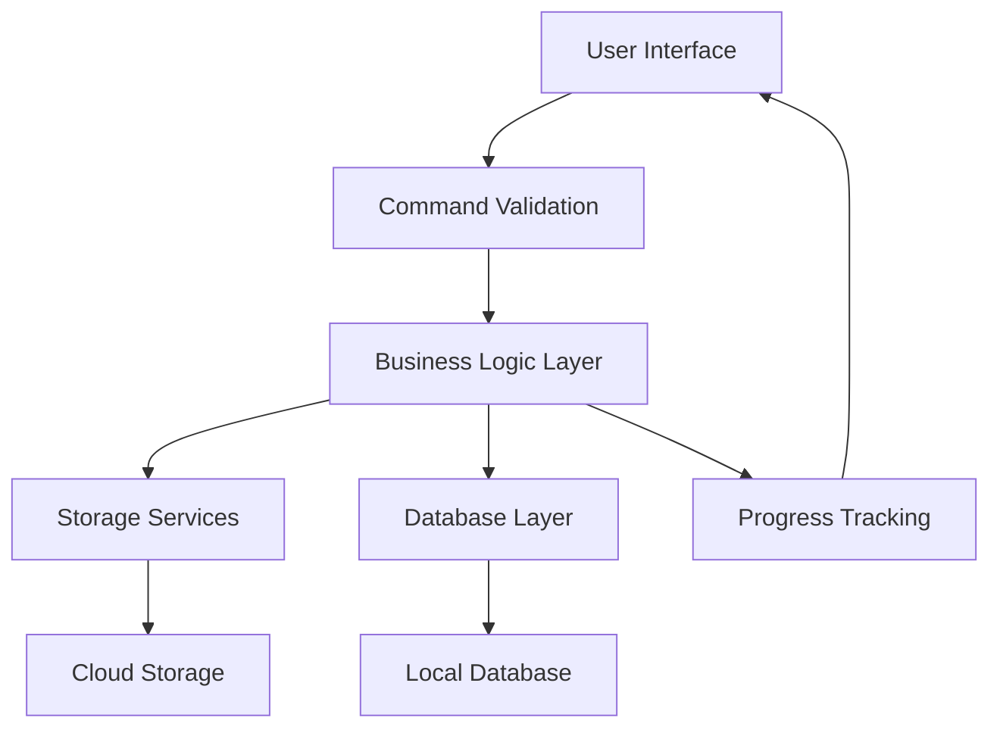
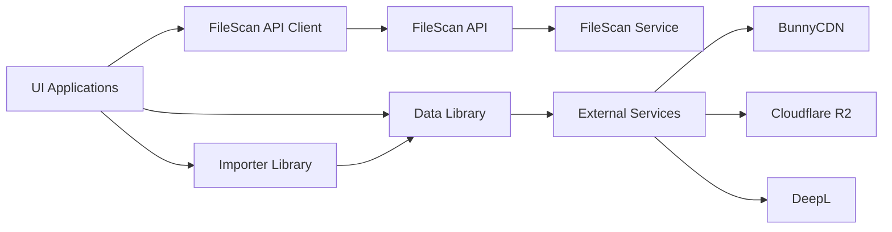

# AlUmmahNowTools - Solution Architecture

## ??? Overview

AlUmmahNowTools is a comprehensive .NET 8 solution for video content management, processing, and cloud storage operations. The solution follows modern architectural principles including clean architecture, dependency injection, and separation of concerns.

## ?? Solution Structure

```
AlUmmahNowTools/
??? AlUmmahNow.Data/                    # Shared Data Library
??? AlUmmahNow.Importer/                # Core Import Logic Library  
??? AlUmmahNow.DataImporter/            # CLI Import Application
??? AlUmmahNow.BunnyBulkUploader/       # CLI Bulk Upload Application
??? AlUmmahNow.VisualImporter/          # WinUI 3 Visual Application
??? AlUmmahNow.FileScanService/         # Background Scanning Service
??? AlUmmahNow.FileScanApi/             # REST API for File Scanning
??? AlUmmahNow.Tests/                   # Unit Tests
??? .github/copilot-instructions.md    # Development Guidelines
```

## ?? Core Principles

### **Single Responsibility Principle**
- Each project has a distinct purpose and responsibility
- Classes are focused on specific domains (storage, import, validation)
- Clear separation between UI, business logic, and data access

### **Dependency Injection**
- All services registered in DI container
- Interface-based design for testability
- Configuration through dependency injection

### **Clean Architecture**
- Domain models in shared library
- Business logic separated from infrastructure
- UI layers depend on abstractions, not implementations

## ?? Project Architecture

### **AlUmmahNow.Data** - Shared Foundation
```
AlUmmahNow.Data/
??? Database/                   # Entity Framework DbContext
??? Models/                     # Domain Models
?   ??? FileScanning/          # File scanning entities
?   ??? Video/                 # Video-related models
?   ??? Storage/               # Storage abstractions
??? Storage/                    # Storage Implementations
?   ??? BunnyStorageClient.cs  # BunnyCDN integration
?   ??? R2Client.cs            # Cloudflare R2 integration
?   ??? IStorageClient.cs      # Storage abstraction
??? Video/                      # Video Services
?   ??? BunnyStreamClient.cs   # Video streaming API
??? Translation/                # Translation Services
    ??? DeepLClient.cs         # DeepL translation API
```

**Responsibilities:**
- ? Domain models and entities
- ? Storage abstractions and implementations
- ? External service integrations (BunnyCDN, Cloudflare R2, DeepL)
- ? Database context and configurations

### **AlUmmahNow.Importer** - Business Logic Core
```
AlUmmahNow.Importer/
??? Core/                       # Core import interfaces
??? VideoImporter.cs           # Main import orchestrator
??? SimpleVideoUploader.cs     # Basic upload operations
??? ImportCommandExecutor.cs   # CLI command handling
```

**Responsibilities:**
- ? Centralized import business logic
- ? Session management and progress tracking
- ? Retry logic and error handling
- ? Cross-cutting concerns for all applications

### **AlUmmahNow.DataImporter** - CLI Interface
```
AlUmmahNow.DataImporter/
??? Commands/                   # Command handlers
?   ??? CommandExecutor.cs     # Business operation execution
?   ??? CommandValidator.cs    # Input validation
??? Services/                   # Application services
?   ??? FileScanApiClient.cs   # API communication
??? Program.cs                 # Application bootstrap
```

**Responsibilities:**
- ? Command line interface
- ? API client for file scanning service
- ? Input validation and routing
- ? Console output formatting

### **AlUmmahNow.VisualImporter** - GUI Interface
```
AlUmmahNow.VisualImporter/
??? Views/                      # UI Views (XAML)
??? ViewModels/                 # MVVM ViewModels
??? Services/                   # UI-specific services
??? Models/                     # UI models
??? App.xaml.cs                # Application entry point
```

**Responsibilities:**
- ? WinUI 3 visual interface
- ? MVVM pattern implementation
- ? Real-time progress visualization
- ? Session management UI

### **AlUmmahNow.FileScanService** - Background Processing
```
AlUmmahNow.FileScanService/
??? Services/                   # Background services
??? Program.cs                 # Service host setup
```

**Responsibilities:**
- ? Windows Service for background file scanning
- ? Long-running operations
- ? Scheduled tasks and monitoring

### **AlUmmahNow.FileScanApi** - REST API
```
AlUmmahNow.FileScanApi/
??? Controllers/                # REST endpoints
??? Services/                   # API-specific services
??? Program.cs                 # Web API startup
```

**Responsibilities:**
- ? REST API for file scanning operations
- ? Session management endpoints
- ? Status monitoring and reporting

## ?? Data Flow Architecture

### **Import Process Flow**


### **Service Dependencies**


## ?? Key Components

### **Storage Layer**
- **Abstraction**: `IStorageClient<T>` interface
- **Implementations**: 
  - `BunnyStorageClient` for BunnyCDN
  - `R2Client` for Cloudflare R2
- **Features**: Upload, download, list, delete operations

### **Import Engine**
- **VideoImporter**: Main orchestrator with session tracking
- **SimpleVideoUploader**: Basic upload functionality
- **Progress Tracking**: Real-time progress reporting
- **Resume Capability**: Interrupt and resume support

### **File Scanning**
- **Background Service**: Continuous file monitoring
- **REST API**: Session-based scanning operations
- **Database Tracking**: Persistent scan session storage

### **User Interfaces**
- **CLI**: Command-line interface for automation
- **GUI**: Visual interface for interactive use
- **API**: REST endpoints for integration

## ??? Database Architecture

### **Entity Relationships**
```
ScanSession (1) ???????? (N) ScannedVideoFile
     ?
     ??? (1) ???????? (N) ScannedChannel

ImportSession (1) ???????? (N) ImportVideo
     ?
     ??? (1) ???????? (N) ImportChannel
```

### **Key Entities**
- **ScanSession**: File discovery sessions
- **ImportSession**: Upload operation sessions  
- **ScannedVideoFile**: Discovered video files
- **ImportVideo**: Videos being processed
- **Channels**: Organizational units (folders)

## ?? Configuration Architecture

### **User Secrets Structure**
```json
{
  "R2DB": {
    "S3Api": "https://cloudflare-r2-endpoint",
    "S3Key": "access-key",
    "S3Secret": "secret-key"
  },
  "BunnyVideo": {
    "Zone": "bunny-video-zone",
    "Key": "bunny-api-key",
    "Region": "bunny-region"
  },
  "BunnyStream": {
    "Key": "bunny-stream-key"
  },
  "DeepL": {
    "ApiKey": "deepl-api-key",
    "IsFreeApi": false
  }
}
```

### **Configuration Hierarchy**
1. **User Secrets** (Development)
2. **Environment Variables** (Production)
3. **appsettings.json** (Defaults)
4. **Command Line Arguments** (Runtime)

## ?? Deployment Architecture

### **Development Environment**
- **IDE**: Visual Studio 2022 / VS Code
- **Runtime**: .NET 8.0 SDK
- **Database**: SQL Server LocalDB / SQLite
- **Storage**: Local file system (testing)

### **Production Environment**
- **Runtime**: .NET 8.0 Runtime
- **Database**: SQL Server / SQLite
- **Storage**: Cloudflare R2 + BunnyCDN
- **Services**: Windows Services / Linux systemd

### **Deployment Targets**
- **Self-Contained**: Single executable with runtime included
- **Framework-Dependent**: Requires .NET 8 runtime
- **Platform-Specific**: Windows (GUI), Linux (CLI/API)

## ?? Security Architecture

### **Authentication & Authorization**
- **API Keys**: Secure storage in user secrets
- **Connection Strings**: Encrypted in production
- **Access Control**: Service-level authentication

### **Data Protection**
- **Encryption in Transit**: HTTPS for all API calls
- **Encryption at Rest**: Cloud storage encryption
- **Sensitive Data**: Excluded from logs and telemetry

## ?? Scalability Considerations

### **Performance Features**
- **Async/Await**: Non-blocking operations throughout
- **Progress Streaming**: Real-time status updates
- **Chunked Uploads**: Large file handling
- **Connection Pooling**: Efficient HTTP client usage

### **Extensibility Points**
- **Storage Providers**: Plugin architecture for new storage
- **Import Strategies**: Configurable import workflows
- **UI Frameworks**: Shared business logic across UIs
- **Translation Services**: Pluggable translation providers

## ?? Testing Architecture

### **Test Strategy**
- **Unit Tests**: Business logic and services
- **Integration Tests**: Database and external APIs
- **Mock Objects**: External service dependencies
- **Test Data**: Synthetic test scenarios

### **Coverage Areas**
- ? Storage client operations
- ? Import workflow logic
- ? Command validation
- ? API client functionality
- ? Model serialization/deserialization

## ?? Quality Assurance

### **Code Quality**
- **SOLID Principles**: Single responsibility, dependency inversion
- **Clean Code**: Readable, maintainable implementations
- **Error Handling**: Comprehensive exception management
- **Logging**: Structured logging throughout

### **Documentation**
- **XML Documentation**: All public APIs documented
- **Architecture Documentation**: This document
- **User Guides**: CLI and GUI usage instructions
- **API Documentation**: REST endpoint specifications

---

## ?? Summary

AlUmmahNowTools implements a modern, scalable architecture that separates concerns across multiple layers while maintaining consistency through shared libraries. The solution supports multiple user interfaces (CLI, GUI, API) backed by a common business logic layer, with flexible storage and translation capabilities.

**Key Architectural Benefits:**
- ? **Maintainability**: Clear separation of concerns
- ? **Testability**: Dependency injection and interfaces
- ? **Scalability**: Async operations and modular design  
- ? **Extensibility**: Plugin architecture for storage and services
- ? **Reliability**: Comprehensive error handling and logging