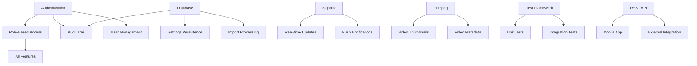

# AlUmmahNow Visual Importer - Feature Status Matrix

## Overview

This matrix provides a comprehensive view of all features in the AlUmmahNow Visual Importer application, showing their current implementation status, quality metrics, and required actions.

---

## Status Legend

| Symbol | Status | Description |
|--------|--------|-------------|
| ✅ | Complete | Fully implemented and tested |
| 🟡 | Partial | Partially implemented, needs completion |
| 🔴 | Missing | Not implemented |
| 🐛 | Buggy | Implemented but has issues |
| 🚧 | In Progress | Currently being developed |

## Quality Metrics

| Symbol | Quality | Description |
|--------|---------|-------------|
| ⭐⭐⭐ | Excellent | Production ready, well tested |
| ⭐⭐ | Good | Functional, minor issues |
| ⭐ | Poor | Works but needs improvement |
| ❌ | Failed | Non-functional or critical issues |

---

## Core Features Matrix

### 1. Watch Management

| Feature | Status | Quality | UI | Backend | Tests | Documentation | Notes |
|---------|--------|---------|-------|---------|--------|--------------|-------|
| **Create Single Watch** | ✅ | ⭐⭐ | ✅ | ✅ | 🔴 | 🔴 | Real-time validation working |
| Channel Name Validation | ✅ | ⭐⭐ | ✅ | ✅ | 🔴 | 🔴 | Checks for duplicates |
| Directory Path Validation | ✅ | ⭐⭐ | ✅ | ✅ | 🔴 | 🔴 | Verifies path exists |
| Processing Delay Config | ✅ | ⭐⭐ | ✅ | ✅ | 🔴 | 🔴 | 1-60 seconds slider |
| Extension Selection | ✅ | ⭐⭐ | ✅ | ✅ | 🔴 | 🔴 | Pre-populated defaults |
| Subdirectory Option | ✅ | ⭐⭐ | ✅ | ✅ | 🔴 | 🔴 | Checkbox control |
| **Batch Create - Template** | ✅ | ⭐⭐ | ✅ | ✅ | 🔴 | 🔴 | Template-based creation |
| Template Selection | ✅ | ⭐⭐ | ✅ | ✅ | 🔴 | 🔴 | Dropdown with descriptions |
| Preview Generation | ✅ | ⭐⭐ | ✅ | ✅ | 🔴 | 🔴 | Shows watches to create |
| Progress Tracking | ✅ | ⭐⭐ | ✅ | ✅ | 🔴 | 🔴 | Progress bar with count |
| **Batch Create - Import** | ✅ | ⭐ | ✅ | ✅ | 🔴 | 🔴 | CSV/JSON import |
| File Format Validation | ✅ | ⭐ | ✅ | ✅ | 🔴 | 🔴 | Checks CSV/JSON format |
| Import Validation | ✅ | ⭐⭐ | ✅ | ✅ | 🔴 | 🔴 | Shows validation errors |
| Selective Import | 🟡 | ⭐ | ✅ | 🟡 | 🔴 | 🔴 | Can't exclude invalid items |
| **Active Watch Monitoring** | ✅ | ⭐⭐ | ✅ | ✅ | 🔴 | 🔴 | Real-time status updates |
| Watch Status Display | ✅ | ⭐⭐ | ✅ | ✅ | 🔴 | 🔴 | Active/Inactive indicator |
| File Count Updates | ✅ | ⭐⭐ | ✅ | ✅ | 🔴 | 🔴 | Real-time via SignalR |
| Stop Watch | ✅ | ⭐⭐ | ✅ | ✅ | 🔴 | 🔴 | Stop button per watch |
| Delete Watch | ✅ | ⭐ | ✅ | ✅ | 🔴 | 🔴 | No confirmation dialog |
| Watch Statistics | ✅ | ⭐⭐ | ✅ | ✅ | 🔴 | 🔴 | Dashboard cards |

### 2. Approval Workflow

| Feature | Status | Quality | UI | Backend | Tests | Documentation | Notes |
|---------|--------|---------|-------|---------|--------|--------------|-------|
| **Pending Approvals List** | ✅ | ⭐⭐ | ✅ | ✅ | 🔴 | 🔴 | Filterable list view |
| File Information Display | ✅ | ⭐⭐⭐ | ✅ | ✅ | 🔴 | 🔴 | All metadata shown |
| Individual Approval | ✅ | ⭐⭐ | ✅ | ✅ | 🔴 | 🔴 | Approve button per item |
| Individual Rejection | ✅ | ⭐⭐ | ✅ | ✅ | 🔴 | 🔴 | Reject button per item |
| Bulk Selection | ✅ | ⭐⭐ | ✅ | ✅ | 🔴 | 🔴 | Checkbox selection |
| Bulk Approval | ✅ | ⭐⭐ | ✅ | ✅ | 🔴 | 🔴 | Approve selected items |
| Bulk Rejection | ✅ | ⭐⭐ | ✅ | ✅ | 🔴 | 🔴 | Reject selected items |
| **Advanced Filtering** | ✅ | ⭐⭐⭐ | ✅ | ✅ | 🔴 | 🔴 | Multiple filter options |
| Channel Filter | ✅ | ⭐⭐⭐ | ✅ | ✅ | 🔴 | 🔴 | Dropdown selection |
| Priority Filter | ✅ | ⭐⭐⭐ | ✅ | ✅ | 🔴 | 🔴 | 1-5 priority levels |
| Size Range Filter | ✅ | ⭐⭐ | ✅ | ✅ | 🔴 | 🔴 | Min/Max inputs |
| Date Range Filter | ✅ | ⭐⭐ | ✅ | ✅ | 🔴 | 🔴 | Date pickers |
| Extension Filter | ✅ | ⭐⭐ | ✅ | ✅ | 🔴 | 🔴 | Comma-separated list |
| **Filter Presets** | ✅ | ⭐⭐ | ✅ | ✅ | 🔴 | 🔴 | Save/load filters |
| Save Preset | ✅ | ⭐⭐ | ✅ | ✅ | 🔴 | 🔴 | Name and description |
| Load Preset | ✅ | ⭐⭐ | ✅ | ✅ | 🔴 | 🔴 | Apply saved filters |
| Delete Preset | ✅ | ⭐ | ✅ | ✅ | 🔴 | 🔴 | No confirmation |
| Set Default | ✅ | ⭐⭐ | ✅ | ✅ | 🔴 | 🔴 | Auto-apply on load |
| **File Preview** | ✅ | ⭐⭐ | ✅ | ✅ | 🔴 | 🔴 | Video preview panel |
| Thumbnail Generation | ✅ | ⭐⭐ | ✅ | ✅ | 🔴 | 🔴 | FFmpeg integration |
| Video Metadata | ✅ | ⭐⭐ | ✅ | ✅ | 🔴 | 🔴 | Duration, codec, etc. |
| Refresh Thumbnail | ✅ | ⭐⭐ | ✅ | ✅ | 🔴 | 🔴 | Regenerate on demand |
| **Activity Logging** | ✅ | ⭐⭐ | ✅ | ✅ | 🔴 | 🔴 | In-memory log |
| Log Display | ✅ | ⭐⭐ | ✅ | ✅ | 🔴 | 🔴 | Scrollable list |
| Log Types | ✅ | ⭐⭐ | ✅ | ✅ | 🔴 | 🔴 | Info/Success/Warning/Error |
| Clear Log | ✅ | ⭐⭐ | ✅ | ✅ | 🔴 | 🔴 | Clear button |
| **Sorting** | ✅ | ⭐⭐ | ✅ | ✅ | 🔴 | 🔴 | Multiple sort options |
| Sort by Date | ✅ | ⭐⭐ | ✅ | ✅ | 🔴 | 🔴 | Ascending/Descending |
| Sort by Name | ✅ | ⭐⭐ | ✅ | ✅ | 🔴 | 🔴 | Alphabetical |
| Sort by Size | ✅ | ⭐⭐ | ✅ | ✅ | 🔴 | 🔴 | File size |
| Sort by Priority | ✅ | ⭐⭐ | ✅ | ✅ | 🔴 | 🔴 | Priority level |

### 3. Analytics Dashboard

| Feature | Status | Quality | UI | Backend | Tests | Documentation | Notes |
|---------|--------|---------|-------|---------|--------|--------------|-------|
| **Statistics Overview** | ✅ | ⭐⭐ | ✅ | ✅ | 🔴 | 🔴 | Key metrics cards |
| Total Approvals | ✅ | ⭐⭐ | ✅ | ✅ | 🔴 | 🔴 | Count with trend |
| Approval Rate | ✅ | ⭐⭐ | ✅ | ✅ | 🔴 | 🔴 | Percentage display |
| Average Time | ✅ | ⭐⭐ | ✅ | ✅ | 🔴 | 🔴 | Hours to approval |
| Files Pending | ✅ | ⭐⭐ | ✅ | ✅ | 🔴 | 🔴 | Current count |
| Total Size | ✅ | ⭐⭐ | ✅ | ✅ | 🔴 | 🔴 | Formatted size |
| **Time Period Selection** | ✅ | ⭐⭐ | ✅ | ✅ | 🔴 | 🔴 | Multiple periods |
| Today | ✅ | ⭐⭐ | ✅ | ✅ | 🔴 | 🔴 | Current day |
| This Week | ✅ | ⭐⭐ | ✅ | ✅ | 🔴 | 🔴 | Current week |
| This Month | ✅ | ⭐⭐ | ✅ | ✅ | 🔴 | 🔴 | Current month |
| All Time | ✅ | ⭐⭐ | ✅ | ✅ | 🔴 | 🔴 | All data |
| Custom Range | 🔴 | ❌ | 🔴 | 🔴 | 🔴 | 🔴 | Not implemented |
| **Visualizations** | ✅ | ⭐⭐ | ✅ | ✅ | 🔴 | 🔴 | Charts and graphs |
| Approval Trends | ✅ | ⭐⭐ | ✅ | ✅ | 🔴 | 🔴 | Bar chart |
| Priority Distribution | ✅ | ⭐⭐ | ✅ | ✅ | 🔴 | 🔴 | Progress bars |
| Top Channels | ✅ | ⭐⭐ | ✅ | ✅ | 🔴 | 🔴 | Ranked list |
| Peak Hours | ✅ | ⭐⭐ | ✅ | ✅ | 🔴 | 🔴 | Heatmap |
| Recent Activity | ✅ | ⭐⭐ | ✅ | ✅ | 🔴 | 🔴 | Activity feed |
| **Export** | 🟡 | ⭐ | ✅ | 🟡 | 🔴 | 🔴 | Partial implementation |
| Export to CSV | 🟡 | ⭐ | ✅ | 🟡 | 🔴 | 🔴 | Button exists, no logic |
| Export to Excel | 🔴 | ❌ | 🔴 | 🔴 | 🔴 | 🔴 | Not implemented |
| Export to PDF | 🔴 | ❌ | 🔴 | 🔴 | 🔴 | 🔴 | Not implemented |

### 4. Service Management

| Feature | Status | Quality | UI | Backend | Tests | Documentation | Notes |
|---------|--------|---------|-------|---------|--------|--------------|-------|
| **Service Status Page** | 🟡 | ⭐ | ✅ | 🟡 | 🔴 | 🔴 | UI exists, partial backend |
| Service List | ✅ | ⭐ | ✅ | 🟡 | 🔴 | 🔴 | Shows services |
| Status Display | 🟡 | ⭐ | ✅ | 🟡 | 🔴 | 🔴 | Mock data only |
| Start/Stop Controls | 🔴 | ❌ | ✅ | 🔴 | 🔴 | 🔴 | Buttons not wired |
| Resource Monitoring | 🔴 | ❌ | 🟡 | 🔴 | 🔴 | 🔴 | No real metrics |
| Service Logs | 🔴 | ❌ | 🔴 | 🔴 | 🔴 | 🔴 | Not implemented |
| Auto-restart | 🔴 | ❌ | 🔴 | 🔴 | 🔴 | 🔴 | Not implemented |
| Health Checks | 🔴 | ❌ | 🔴 | 🔴 | 🔴 | 🔴 | Not implemented |

### 5. File Import

| Feature | Status | Quality | UI | Backend | Tests | Documentation | Notes |
|---------|--------|---------|-------|---------|--------|--------------|-------|
| **Import View** | 🟡 | ⭐ | ✅ | 🟡 | 🔴 | 🔴 | UI exists, logic incomplete |
| Approved Files List | 🟡 | ⭐ | ✅ | 🟡 | 🔴 | 🔴 | Mock data |
| File Selection | 🟡 | ⭐ | ✅ | 🔴 | 🔴 | 🔴 | UI only |
| Import Settings | 🟡 | ⭐ | ✅ | 🔴 | 🔴 | 🔴 | UI only |
| Start Import | 🔴 | ❌ | ✅ | 🔴 | 🔴 | 🔴 | Not functional |
| Progress Tracking | 🔴 | ❌ | 🟡 | 🔴 | 🔴 | 🔴 | No backend |
| Error Handling | 🔴 | ❌ | 🔴 | 🔴 | 🔴 | 🔴 | Not implemented |
| Rollback | 🔴 | ❌ | 🔴 | 🔴 | 🔴 | 🔴 | Not implemented |

### 6. File Discovery

| Feature | Status | Quality | UI | Backend | Tests | Documentation | Notes |
|---------|--------|---------|-------|---------|--------|--------------|-------|
| **Discovery Page** | 🟡 | ⭐ | ✅ | 🟡 | 🔴 | 🔴 | Basic UI exists |
| Directory Selection | 🟡 | ⭐ | ✅ | 🔴 | 🔴 | 🔴 | UI only |
| Scan Options | 🟡 | ⭐ | ✅ | 🔴 | 🔴 | 🔴 | UI only |
| Start Scan | 🔴 | ❌ | ✅ | 🔴 | 🔴 | 🔴 | Not functional |
| Results Display | 🔴 | ❌ | 🟡 | 🔴 | 🔴 | 🔴 | No results shown |
| Export Results | 🔴 | ❌ | 🔴 | 🔴 | 🔴 | 🔴 | Not implemented |
| Add to Queue | 🔴 | ❌ | 🔴 | 🔴 | 🔴 | 🔴 | Not implemented |

### 7. Settings Management

| Feature | Status | Quality | UI | Backend | Tests | Documentation | Notes |
|---------|--------|---------|-------|---------|--------|--------------|-------|
| **Settings Page** | 🟡 | ⭐ | ✅ | 🔴 | 🔴 | 🔴 | UI only |
| General Settings | 🟡 | ⭐ | ✅ | 🔴 | 🔴 | 🔴 | No persistence |
| Watch Settings | 🟡 | ⭐ | ✅ | 🔴 | 🔴 | 🔴 | No persistence |
| Approval Settings | 🟡 | ⭐ | ✅ | 🔴 | 🔴 | 🔴 | No persistence |
| Import Settings | 🟡 | ⭐ | ✅ | 🔴 | 🔴 | 🔴 | No persistence |
| Save Settings | 🔴 | ❌ | ✅ | 🔴 | 🔴 | 🔴 | Not functional |
| Load Settings | 🔴 | ❌ | 🔴 | 🔴 | 🔴 | 🔴 | Not implemented |
| Reset Defaults | 🔴 | ❌ | ✅ | 🔴 | 🔴 | 🔴 | Not functional |
| Import/Export | 🔴 | ❌ | 🔴 | 🔴 | 🔴 | 🔴 | Not implemented |

---

## Infrastructure & Support Features

### 8. Authentication & Authorization

| Feature | Status | Quality | UI | Backend | Tests | Documentation | Notes |
|---------|--------|---------|-------|---------|--------|--------------|-------|
| **Login System** | 🔴 | ❌ | 🟡 | 🔴 | 🔴 | 🔴 | Login view exists |
| Windows Auth | 🔴 | ❌ | 🔴 | 🔴 | 🔴 | 🔴 | Not implemented |
| Username/Password | 🔴 | ❌ | 🟡 | 🔴 | 🔴 | 🔴 | UI only |
| Session Management | 🔴 | ❌ | 🔴 | 🔴 | 🔴 | 🔴 | Not implemented |
| Logout | 🔴 | ❌ | 🔴 | 🔴 | 🔴 | 🔴 | Not implemented |
| **Role-Based Access** | 🔴 | ❌ | 🔴 | 🔴 | 🔴 | 🔴 | Not implemented |
| Role Definition | 🔴 | ❌ | 🔴 | 🔴 | 🔴 | 🔴 | Not implemented |
| Permission Checks | 🔴 | ❌ | 🔴 | 🔴 | 🔴 | 🔴 | Not implemented |
| User Management | 🔴 | ❌ | 🔴 | 🔴 | 🔴 | 🔴 | Not implemented |

### 9. Real-time Communication

| Feature | Status | Quality | UI | Backend | Tests | Documentation | Notes |
|---------|--------|---------|-------|---------|--------|--------------|-------|
| **SignalR Integration** | ✅ | ⭐⭐ | ✅ | ✅ | 🔴 | 🔴 | Working connection |
| Connection Management | 🟡 | ⭐ | ✅ | ✅ | 🔴 | 🔴 | Basic reconnection |
| Event Handling | ✅ | ⭐⭐ | ✅ | ✅ | 🔴 | 🔴 | Events processed |
| Message Queue | 🔴 | ❌ | 🔴 | 🔴 | 🔴 | 🔴 | No offline queue |
| Connection Status | 🟡 | ⭐ | 🟡 | ✅ | 🔴 | 🔴 | Limited display |

### 10. Data Persistence

| Feature | Status | Quality | UI | Backend | Tests | Documentation | Notes |
|---------|--------|---------|-------|---------|--------|--------------|-------|
| **Database Operations** | 🟡 | ⭐ | N/A | 🟡 | 🔴 | 🔴 | Basic CRUD |
| Entity Framework | 🟡 | ⭐ | N/A | 🟡 | 🔴 | 🔴 | Partially configured |
| Migrations | 🔴 | ❌ | N/A | 🔴 | 🔴 | 🔴 | Not set up |
| Transactions | 🔴 | ❌ | N/A | 🔴 | 🔴 | 🔴 | Not implemented |
| Connection Pooling | 🔴 | ❌ | N/A | 🔴 | 🔴 | 🔴 | Not configured |

### 11. Notifications

| Feature | Status | Quality | UI | Backend | Tests | Documentation | Notes |
|---------|--------|---------|-------|---------|--------|--------------|-------|
| **In-App Notifications** | ✅ | ⭐⭐ | ✅ | ✅ | 🔴 | 🔴 | Toast notifications |
| Success Messages | ✅ | ⭐⭐ | ✅ | ✅ | 🔴 | 🔴 | Green toasts |
| Error Messages | ✅ | ⭐⭐ | ✅ | ✅ | 🔴 | 🔴 | Red toasts |
| Info Messages | ✅ | ⭐⭐ | ✅ | ✅ | 🔴 | 🔴 | Blue toasts |
| **Email Notifications** | 🔴 | ❌ | 🔴 | 🔴 | 🔴 | 🔴 | Not implemented |
| **Push Notifications** | 🔴 | ❌ | 🔴 | 🔴 | 🔴 | 🔴 | Not implemented |

### 12. Logging & Monitoring

| Feature | Status | Quality | UI | Backend | Tests | Documentation | Notes |
|---------|--------|---------|-------|---------|--------|--------------|-------|
| **Application Logging** | 🟡 | ⭐ | N/A | 🟡 | 🔴 | 🔴 | Basic console logging |
| File Logging | 🔴 | ❌ | N/A | 🔴 | 🔴 | 🔴 | Not implemented |
| Database Logging | 🔴 | ❌ | N/A | 🔴 | 🔴 | 🔴 | Not implemented |
| **Audit Trail** | 🔴 | ❌ | 🔴 | 🔴 | 🔴 | 🔴 | Not implemented |
| **Performance Monitoring** | 🔴 | ❌ | 🔴 | 🔴 | 🔴 | 🔴 | Not implemented |
| **Error Tracking** | 🔴 | ❌ | 🔴 | 🔴 | 🔴 | 🔴 | Not implemented |

---

## Cross-Cutting Concerns

### 13. Performance

| Aspect | Status | Quality | Notes |
|--------|--------|---------|-------|
| **UI Responsiveness** | 🐛 | ⭐ | Freezes on heavy operations |
| Async Operations | 🟡 | ⭐ | Some blocking calls remain |
| Caching | 🔴 | ❌ | No caching implemented |
| Lazy Loading | 🔴 | ❌ | All data loaded at once |
| Virtualization | 🔴 | ❌ | Large lists not virtualized |
| **Memory Management** | 🐛 | ⭐ | Memory leaks detected |
| Disposal | 🟡 | ⭐ | Partial IDisposable implementation |
| Resource Cleanup | 🟡 | ⭐ | Some resources not released |

### 14. Security

| Aspect | Status | Quality | Notes |
|--------|--------|---------|-------|
| **Input Validation** | 🔴 | ❌ | No sanitization |
| SQL Injection Prevention | 🔴 | ❌ | Vulnerable |
| Path Traversal Prevention | 🔴 | ❌ | Vulnerable |
| XSS Prevention | 🔴 | ❌ | No protection |
| **Data Protection** | 🔴 | ❌ | No encryption |
| Credentials Storage | 🔴 | ❌ | Plaintext |
| Sensitive Data | 🔴 | ❌ | Not masked |
| **Communication** | 🟡 | ⭐ | HTTP not HTTPS |

### 15. User Experience

| Aspect | Status | Quality | Notes |
|--------|--------|---------|-------|
| **Feedback** | 🟡 | ⭐ | Limited feedback |
| Loading States | 🟡 | ⭐ | Some missing |
| Error Messages | 🟡 | ⭐ | Not user-friendly |
| Confirmations | 🔴 | ❌ | No destructive action confirms |
| **Accessibility** | 🔴 | ❌ | Not WCAG compliant |
| Keyboard Navigation | 🔴 | ❌ | Mouse only |
| Screen Reader | 🔴 | ❌ | No ARIA labels |
| High Contrast | 🔴 | ❌ | Not supported |
| **Responsiveness** | 🔴 | ❌ | Desktop only |

### 16. Testing

| Type | Coverage | Status | Notes |
|------|----------|--------|-------|
| **Unit Tests** | 0% | 🔴 | No test project |
| ViewModels | 0% | 🔴 | Not tested |
| Services | 0% | 🔴 | Not tested |
| Helpers | 0% | 🔴 | Not tested |
| **Integration Tests** | 0% | 🔴 | Not implemented |
| **UI Tests** | 0% | 🔴 | Not implemented |
| **Performance Tests** | 0% | 🔴 | Not implemented |
| **Security Tests** | 0% | 🔴 | Not implemented |

---

## Feature Readiness Summary

### Production Ready Features ✅
- Watch creation and management (needs tests)
- Approval workflow with filtering (needs tests)
- Filter presets management (needs tests)
- Video preview with thumbnails (needs tests)
- Analytics dashboard (needs backend improvements)

### Beta Features 🟡
- Batch watch operations (needs error handling)
- Activity logging (needs persistence)
- Real-time updates (needs reliability improvements)

### Alpha Features 🐛
- Service status monitoring (backend incomplete)
- Import processing (logic missing)
- Settings management (no persistence)

### Not Implemented ❌
- Authentication and authorization
- User management
- File discovery backend
- Email notifications
- Audit trail
- Backup/restore
- API layer
- Mobile support
- Internationalization

---

## Quality Metrics Overview

### Overall Application Status

| Metric | Score | Target | Gap |
|--------|-------|--------|-----|
| Feature Completeness | 45% | 100% | -55% |
| Code Quality | 35% | 80% | -45% |
| Test Coverage | 0% | 80% | -80% |
| Documentation | 10% | 90% | -80% |
| Security | 15% | 95% | -80% |
| Performance | 40% | 85% | -45% |
| Accessibility | 5% | 100% | -95% |
| **Overall Health** | **21%** | **87%** | **-66%** |

### Risk Assessment

| Area | Risk Level | Priority |
|------|------------|----------|
| Security | 🔴 Critical | P0 |
| Testing | 🔴 Critical | P0 |
| Authentication | 🔴 Critical | P0 |
| Performance | 🟡 High | P1 |
| Documentation | 🟡 High | P1 |
| Accessibility | 🟡 High | P2 |
| Mobile Support | 🟢 Low | P3 |

---

## Recommendations

### Immediate Actions Required
1. Implement authentication system
2. Add comprehensive input validation
3. Create unit test project with initial tests
4. Fix security vulnerabilities
5. Add error handling throughout

### Short-term Improvements
1. Complete partially implemented features
2. Refactor large ViewModels
3. Implement caching strategy
4. Add missing UI feedback
5. Create user documentation

### Long-term Goals
1. Achieve 80% test coverage
2. Implement all missing features
3. Add mobile support
4. Ensure WCAG compliance
5. Create comprehensive API

---

## Feature Dependencies Map

---

## Conclusion

The AlUmmahNow Visual Importer has achieved approximately **45% feature completeness** with several core features working well. However, critical gaps in security, testing, and authentication make it unsuitable for production use in its current state.

### Strengths
- Watch management fully functional
- Approval workflow feature-rich
- Good UI design and layout
- Real-time updates working

### Critical Weaknesses
- No authentication system
- Zero test coverage
- Security vulnerabilities
- Incomplete error handling

### Path to Production
Following the implementation roadmap with focus on P0 and P1 items will bring the application to production readiness within 12 weeks.

---

*Matrix Version: 1.0.0*
*Assessment Date: October 2024*
*Next Review: November 2024*