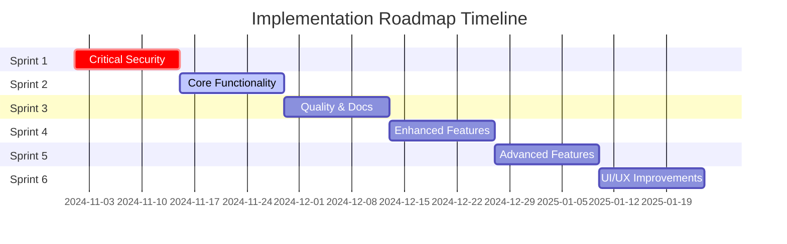

# AlUmmahNow Visual Importer - Implementation Roadmap

## Executive Summary

This roadmap provides a prioritized implementation plan for addressing gaps identified in the AlUmmahNow Visual Importer application. Items are organized by priority (P0-P3) with effort estimates, dependencies, and impact assessments.

---

## Priority Levels

- **P0 (Critical)**: Must fix immediately - Security/stability issues
- **P1 (High)**: Should fix in next sprint - Core functionality
- **P2 (Medium)**: Should fix in coming months - Enhancements
- **P3 (Low)**: Nice to have - Future improvements

## Effort Estimates

- **S (Small)**: 1-2 days
- **M (Medium)**: 3-5 days
- **L (Large)**: 1-2 weeks
- **XL (Extra Large)**: 2-4 weeks

---

## Sprint 1: Critical Security & Stability (2 weeks)

### P0 - Critical Issues (Must fix immediately)

| ID | Feature/Fix | Effort | Dependencies | Impact | Technical Complexity |
|----|-------------|--------|--------------|--------|---------------------|
| P0-001 | **Implement Authentication System** | XL | None | 🔴 Critical - No security without auth | High |
| | - Add Windows Authentication integration - Create login service - Implement session management - Add logout functionality | | | Blocks all user-specific features | - Integrate with Windows Identity - Create AuthService - Add auth middleware |
| P0-002 | **Add Input Validation & Sanitization** | L | None | 🔴 Critical - Prevents injection attacks | Medium |
| | - Validate all user inputs - Sanitize file paths - Prevent SQL injection - Add XSS protection | | | Security vulnerability | - Create validation helpers - Add input filters - Implement sanitization |
| P0-003 | **Fix SignalR Connection Management** | M | None | 🔴 Critical - Lost updates | Medium |
| | - Add reconnection logic - Queue updates during disconnect - Show connection status - Handle connection errors | | | Data consistency issues | - Implement retry policy - Add message queue - Create connection monitor |
| P0-004 | **Add Error Handling Throughout** | L | None | 🔴 Critical - App crashes | Medium |
| | - Wrap all async operations - Add global exception handler - Log all errors - Show user-friendly messages | | | Application stability | - Try-catch blocks - Exception middleware - Error boundary components |
| P0-005 | **Secure File Operations** | M | P0-002 | 🔴 Critical - Path traversal risk | Medium |
| | - Validate file paths - Check permissions - Prevent directory traversal - Add file size limits | | | Security vulnerability | - Path validation - Permission checks - Sandbox file operations |

---

## Sprint 2: Core Functionality (2 weeks)

### P1 - High Priority (Should fix in next sprint)

| ID | Feature/Fix | Effort | Dependencies | Impact | Technical Complexity |
|----|-------------|--------|--------------|--------|---------------------|
| P1-001 | **Create Unit Test Project** | L | None | 🟡 High - Code quality | Medium |
| | - Set up test project - Add testing frameworks - Create test helpers - Write initial tests | | | Prevents regressions | - xUnit setup - Moq for mocking - Test data builders |
| P1-002 | **Refactor Large ViewModels** | XL | P1-001 | 🟡 High - Maintainability | High |
| | - Extract command handlers - Create service layer - Implement MVVM properly - Reduce coupling | | | Code maintainability | - Command pattern - Service extraction - Dependency injection |
| P1-003 | **Implement Caching Strategy** | L | None | 🟡 High - Performance | Medium |
| | - Cache thumbnails - Cache metadata - Cache API responses - Add cache invalidation | | | 10x performance gain | - Memory cache - File cache - Cache policies |
| P1-004 | **Add Loading States & Feedback** | M | None | 🟡 High - User experience | Low |
| | - Progress indicators - Loading overlays - Success messages - Error notifications | | | User confusion | - Loading components - Toast notifications - Progress bars |
| P1-005 | **Fix Performance Bottlenecks** | L | P1-003 | 🟡 High - Responsiveness | Medium |
| | - Async thumbnail generation - Virtualize large lists - Pagination for data - Background processing | | | UI freezing | - Task.Run for heavy ops - Virtual scrolling - Data pagination |
| P1-006 | **Complete Import Service** | L | P0-005 | 🟡 High - Core feature | Medium |
| | - File copy/move logic - Progress tracking - Error handling - Rollback support | | | Feature incomplete | - File operations - Transaction support - Progress events |

---

## Sprint 3: Quality & Documentation (2 weeks)

### P1 - High Priority (Continued)

| ID | Feature/Fix | Effort | Dependencies | Impact | Technical Complexity |
|----|-------------|--------|--------------|--------|---------------------|
| P1-007 | **Create User Documentation** | L | None | 🟡 High - User adoption | Low |
| | - User manual - Quick start guide - Video tutorials - FAQ section | | | User training | - Markdown docs - Screen recordings - Help system |
| P1-008 | **Implement Role-Based Access** | L | P0-001 | 🟡 High - Security | Medium |
| | - Define roles - Implement permissions - Add authorization checks - Role management UI | | | Feature security | - Claims-based auth - Policy authorization - Role provider |
| P1-009 | **Add Audit Logging** | M | P0-001 | 🟡 High - Compliance | Medium |
| | - Log all actions - Track user activities - Store audit trail - Create audit viewer | | | Compliance requirement | - Audit service - Database logging - Log viewer UI |
| P1-010 | **Implement Settings Persistence** | M | None | 🟡 High - Core feature | Low |
| | - Save settings to database - Load on startup - Hot-reload support - Import/export settings | | | Feature incomplete | - Settings service - JSON serialization - File I/O |

---

## Sprint 4: Enhanced Features (2 weeks)

### P2 - Medium Priority (Should fix in coming months)

| ID | Feature/Fix | Effort | Dependencies | Impact | Technical Complexity |
|----|-------------|--------|--------------|--------|---------------------|
| P2-001 | **Add Integration Tests** | L | P1-001 | 🟢 Medium - Quality | Medium |
| | - SignalR tests - Database tests - File system tests - End-to-end tests | | | Test coverage | - Test containers - Integration fixtures - Test database |
| P2-002 | **Improve Accessibility** | L | None | 🟢 Medium - Compliance | Medium |
| | - Add ARIA labels - Keyboard navigation - Screen reader support - High contrast mode | | | WCAG compliance | - Accessibility audit - ARIA attributes - Keyboard handlers |
| P2-003 | **Add Email Notifications** | M | None | 🟢 Medium - User engagement | Medium |
| | - Email service - Notification templates - User preferences - Batch notifications | | | User awareness | - SMTP integration - Template engine - Queue system |
| P2-004 | **Implement Backup/Restore** | L | None | 🟢 Medium - Data safety | Medium |
| | - Database backup - Settings backup - Scheduled backups - Restore functionality | | | Data protection | - Backup service - Compression - Scheduling |
| P2-005 | **Add Search Functionality** | M | None | 🟢 Medium - Usability | Low |
| | - Global search - Filter by search - Search history - Advanced search | | | Find files quickly | - Search service - Full-text search - Search UI |
| P2-006 | **Create REST API** | XL | P0-001 | 🟢 Medium - Integration | High |
| | - API controllers - Swagger documentation - Authentication - Rate limiting | | | Third-party integration | - ASP.NET Core API - OpenAPI spec - JWT auth |

---

## Sprint 5: Advanced Features (2 weeks)

### P2 - Medium Priority (Continued)

| ID | Feature/Fix | Effort | Dependencies | Impact | Technical Complexity |
|----|-------------|--------|--------------|--------|---------------------|
| P2-007 | **Implement Scheduling** | L | None | 🟢 Medium - Automation | Medium |
| | - Schedule imports - Batch scheduling - Recurring tasks - Schedule viewer | | | Process automation | - Quartz.NET - Cron expressions - Job management |
| P2-008 | **Add Monitoring & Alerting** | L | P2-003 | 🟢 Medium - Operations | Medium |
| | - Health checks - Performance metrics - Alert rules - Dashboard | | | System monitoring | - Health endpoints - Metrics collection - Alert service |
| P2-009 | **Optimize Database Queries** | M | None | 🟢 Medium - Performance | Medium |
| | - Query optimization - Index creation - Query caching - Connection pooling | | | Database performance | - Query analysis - Index tuning - EF optimization |
| P2-010 | **Add Export Capabilities** | S | None | 🟢 Medium - Reporting | Low |
| | - Export to Excel - Export to PDF - Custom reports - Report templates | | | Data portability | - EPPlus/ClosedXML - PDF generation - Report builder |

---

## Sprint 6: UI/UX Improvements (2 weeks)

### P3 - Low Priority (Nice to have)

| ID | Feature/Fix | Effort | Dependencies | Impact | Technical Complexity |
|----|-------------|--------|--------------|--------|---------------------|
| P3-001 | **Implement Dark Mode** | M | None | 🟢 Low - User preference | Low |
| | - Theme service - Dark theme colors - Theme switcher - Persist preference | | | User comfort | - Theme provider - CSS variables - Theme storage |
| P3-002 | **Add Drag & Drop** | M | None | 🟢 Low - Convenience | Medium |
| | - File drag & drop - Reorder items - Drop zones - Visual feedback | | | Better UX | - DnD API - Drop handlers - Visual indicators |
| P3-003 | **Multi-language Support** | L | None | 🟢 Low - Localization | Medium |
| | - Resource files - Language selector - RTL support - Date/number formats | | | Global reach | - i18n setup - Resource management - Culture handling |
| P3-004 | **Add Keyboard Shortcuts** | S | None | 🟢 Low - Power users | Low |
| | - Define shortcuts - Shortcut handler - Help overlay - Customization | | | Power user efficiency | - Key bindings - Command pattern - Settings storage |
| P3-005 | **Create Mobile App** | XL | P2-006 | 🟢 Low - Mobile access | High |
| | - Mobile UI - Responsive design - Touch optimization - Offline support | | | Mobile users | - MAUI/React Native - Responsive CSS - PWA |
| P3-006 | **Add AI Features** | XL | P2-006 | 🟢 Low - Innovation | High |
| | - Auto-categorization - Content analysis - Quality scoring - Recommendations | | | Advanced features | - ML.NET/Azure AI - Model training - API integration |

---

## Implementation Timeline

---

## Resource Requirements

### Team Composition

| Role | Sprint 1-2 | Sprint 3-4 | Sprint 5-6 |
|------|------------|------------|------------|
| Senior Developer | 2 | 2 | 1 |
| Mid Developer | 2 | 2 | 2 |
| Junior Developer | 1 | 1 | 2 |
| QA Engineer | 1 | 2 | 2 |
| Technical Writer | 0 | 1 | 1 |
| UI/UX Designer | 0 | 1 | 1 |
| **Total** | **6** | **9** | **9** |

### Infrastructure Requirements

| Component | Current | Required | Timeline |
|-----------|---------|----------|----------|
| Development Servers | 1 | 3 | Sprint 1 |
| Test Environment | 0 | 1 | Sprint 2 |
| Staging Environment | 0 | 1 | Sprint 3 |
| Production Servers | 1 | 2 | Sprint 4 |
| CI/CD Pipeline | None | Jenkins/Azure DevOps | Sprint 2 |
| Monitoring Tools | None | App Insights | Sprint 5 |

---

## Risk Mitigation

### Technical Risks

| Risk | Probability | Impact | Mitigation |
|------|-------------|--------|------------|
| SignalR scaling issues | High | High | Implement Redis backplane |
| FFmpeg compatibility | Medium | High | Create fallback mechanisms |
| Database performance | Medium | Medium | Add read replicas |
| Memory leaks | High | Medium | Implement proper disposal |
| Third-party API changes | Low | High | Version lock dependencies |

### Project Risks

| Risk | Probability | Impact | Mitigation |
|------|-------------|--------|------------|
| Scope creep | High | High | Strict change control |
| Resource availability | Medium | High | Cross-training team |
| Technical debt accumulation | High | Medium | Dedicated refactoring time |
| User adoption | Medium | High | Comprehensive training |
| Security vulnerabilities | Low | Critical | Security audits |

---

## Success Metrics

### Sprint 1 Success Criteria
- ✅ Authentication working
- ✅ No security vulnerabilities
- ✅ Error handling complete
- ✅ Connection stable

### Sprint 2 Success Criteria
- ✅ 50% test coverage
- ✅ Performance improved 5x
- ✅ All loading states added
- ✅ Import fully functional

### Sprint 3 Success Criteria
- ✅ Documentation complete
- ✅ RBAC implemented
- ✅ Audit logging active
- ✅ Settings persistent

### Sprint 4 Success Criteria
- ✅ Integration tests passing
- ✅ WCAG AA compliant
- ✅ Email notifications working
- ✅ API documented

### Sprint 5 Success Criteria
- ✅ Scheduling operational
- ✅ Monitoring active
- ✅ Database optimized
- ✅ Reports generating

### Sprint 6 Success Criteria
- ✅ Dark mode available
- ✅ Drag & drop working
- ✅ 2+ languages supported
- ✅ Mobile app beta

---

## Budget Estimation

### Development Costs

| Phase | Duration | Team Size | Cost Range |
|-------|----------|-----------|------------|
| Sprint 1 | 2 weeks | 6 | $48,000 - $60,000 |
| Sprint 2 | 2 weeks | 6 | $48,000 - $60,000 |
| Sprint 3 | 2 weeks | 9 | $72,000 - $90,000 |
| Sprint 4 | 2 weeks | 9 | $72,000 - $90,000 |
| Sprint 5 | 2 weeks | 9 | $72,000 - $90,000 |
| Sprint 6 | 2 weeks | 9 | $72,000 - $90,000 |
| **Total** | **12 weeks** | **Avg 8** | **$384,000 - $480,000** |

### Additional Costs

| Item | Cost Range |
|------|------------|
| Infrastructure | $5,000 - $10,000/month |
| Licenses | $10,000 - $20,000 |
| Security Audit | $15,000 - $25,000 |
| Training | $10,000 - $15,000 |
| **Total Additional** | **$40,000 - $70,000** |

---

## Delivery Milestones

### Milestone 1: Security Hardened (End of Sprint 1)
- Secure authentication
- Input validation
- Error handling
- Stable connections

### Milestone 2: Core Complete (End of Sprint 2)
- All core features working
- Performance optimized
- Tests established
- Import functional

### Milestone 3: Production Ready (End of Sprint 3)
- Fully documented
- RBAC implemented
- Audit compliant
- Settings complete

### Milestone 4: Enterprise Features (End of Sprint 4)
- API available
- Integrations ready
- Monitoring active
- Accessible

### Milestone 5: Advanced Platform (End of Sprint 5)
- Automation ready
- Scalable architecture
- Advanced reporting
- Operational excellence

### Milestone 6: Next Generation (End of Sprint 6)
- Modern UX
- Multi-platform
- Global ready
- AI-enhanced

---

## Go/No-Go Decision Points

### After Sprint 1
- **Go Criteria**: All P0 issues resolved
- **No-Go**: Security vulnerabilities remain

### After Sprint 2
- **Go Criteria**: Core features stable, 50% test coverage
- **No-Go**: Performance issues persist

### After Sprint 3
- **Go Criteria**: Documentation complete, RBAC working
- **No-Go**: Compliance gaps exist

### After Sprint 4
- **Go Criteria**: API functional, integrations tested
- **No-Go**: Accessibility non-compliant

---

## Communication Plan

### Stakeholder Updates
- Weekly status reports
- Bi-weekly demos
- Sprint retrospectives
- Monthly steering committee

### Team Communication
- Daily standups
- Sprint planning
- Code reviews
- Technical discussions

### User Communication
- Release notes
- Training sessions
- Support documentation
- Feedback channels

---

## Post-Implementation Support

### Phase 1: Hypercare (3 months)
- Daily monitoring
- Immediate bug fixes
- User support
- Performance tuning

### Phase 2: Stabilization (3 months)
- Weekly updates
- Feature refinements
- Documentation updates
- Training continuation

### Phase 3: Continuous Improvement (Ongoing)
- Monthly releases
- Feature requests
- Performance optimization
- Security updates

---

## Conclusion

This implementation roadmap provides a structured approach to transforming the AlUmmahNow Visual Importer into a production-ready, enterprise-grade application. The prioritized approach ensures critical issues are addressed first while building towards a feature-rich, scalable platform.

Success depends on:
1. Maintaining focus on security and stability first
2. Building quality through testing and documentation
3. Iterative delivery with regular stakeholder feedback
4. Managing technical debt proactively
5. Investing in team skills and infrastructure

With proper execution of this roadmap, the application will be ready for production use within 12 weeks, with ongoing enhancements continuing thereafter.

---

*Roadmap Version: 1.0.0*
*Created: October 2024*
*Next Review: November 2024*
*Owner: Development Team Lead*